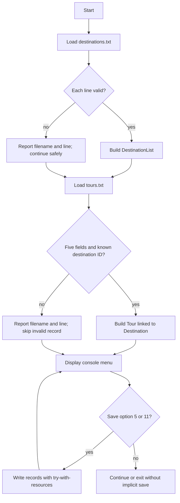

# File flow and error policy

## File schemas

`destinations.txt`: `destinationID,destinationName,region,baseCost`.

`tours.txt`: `tourID,destinationID,tourName,departureDate,price`.

No field may include a comma in this version. Whitespace around values is trimmed on input. A malformed line is not silently accepted.
