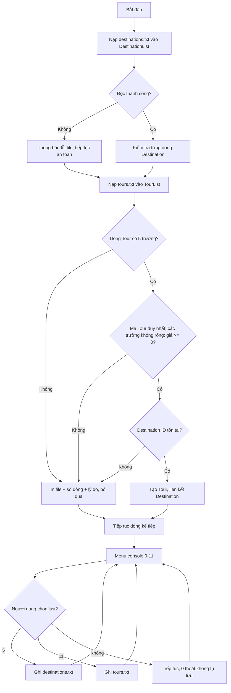

# I.5 — Quy trình nạp/lưu file và xử lý lỗi

**Phụ trách:** Vũ Hữu Thịnh. **Reviewer:** Lê Thuần Trường. **Trạng thái:** Tài liệu hoàn thiện để review.

## Luồng xử lý

## Quy ước file và hợp đồng xử lý

- `destinations.txt`: `destinationID,destinationName,region,baseCost`.
- `tours.txt`: `tourID,destinationID,tourName,departureDate,price`.
- Mỗi dòng Tour gồm đúng 5 trường, cách nhau bằng dấu phẩy, mã Tour không trùng; giá hữu hạn và không âm.
- `DestinationList` phải được nạp trước. `TourList.loadFromFile(filename, destinations)` liên kết tham chiếu ID tới **đối tượng Destination hiện có**, không tạo Destination mới.
- Bỏ qua và thông báo từng dòng sai (file, số dòng, lý do), tiếp tục các dòng còn lại. Hàm nạp trả `false` khi có lỗi dòng; dữ liệu hợp lệ vẫn được nạp.
- File thiếu/không đọc được: trả `false` và **giữ danh sách Tour hiện tại**. File mở thành công: thay dữ liệu hiện tại bằng các dòng hợp lệ.
- `saveToFile` ghi UTF-8 và sử dụng try-with-resources; trả `true` khi ghi xong, `false` khi I/O lỗi.
- `searchId` trả chỉ số hoặc `-1`, so sánh chuỗi bằng `equalsIgnoreCase` chứ không dùng `==`.
- Menu 0 thoát mà không lưu tự động; lựa chọn 11 do `TourManager` gọi tới `TourList.saveToFile`.

## Biên giới module

Các phương thức `addTour`, `removeTour`, `updateTour`, `listTours` và `printBasedDestinationName` đã được tích hợp ở phạm vi module Tour. Hàm mở rộng `findToursByPriceRange` chỉ xử lý lọc danh sách, không sửa dữ liệu gốc. Chữ ký mã nguồn dùng camelCase `searchId` và nhận `DestinationList` khi nạp file.

## Trường hợp biên

1. File thiếu/đường dẫn sai: báo lỗi, giữ dữ liệu cũ.
2. Dòng thiếu trường, thừa trường hoặc trống: báo lỗi và bỏ qua.
3. Destination ID chưa có, Tour ID bị trùng: báo lỗi và bỏ qua.
4. Giá âm, NaN, Infinity, chữ không parse được: báo lỗi và bỏ qua.
5. Đường dẫn ghi sai: thông báo lỗi, trả false.
6. File lưu chỉ thay đổi khi người dùng chọn lưu.
